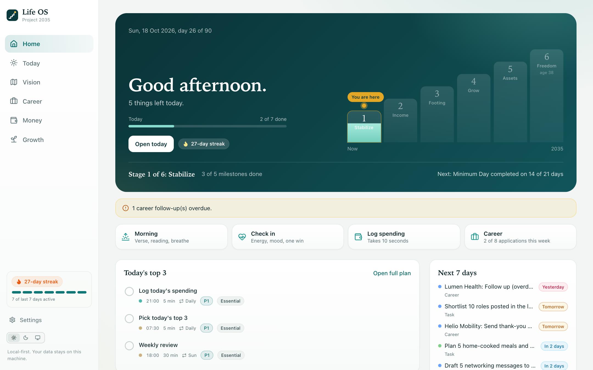
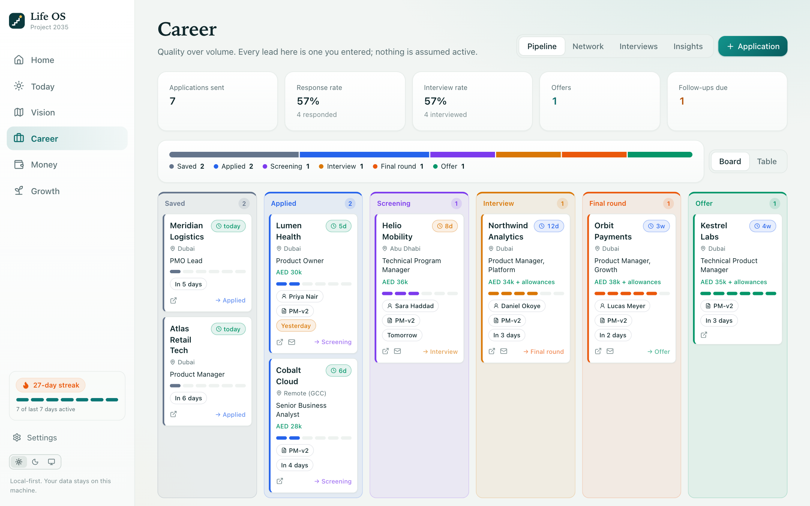
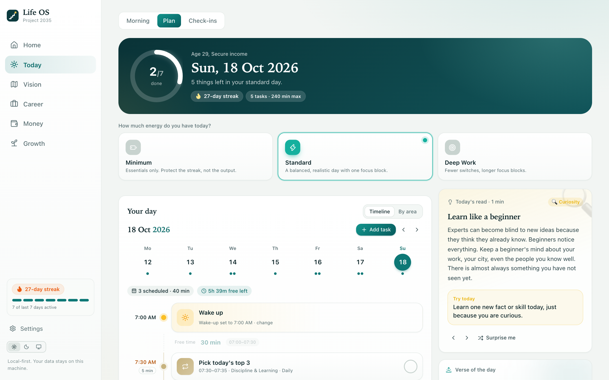
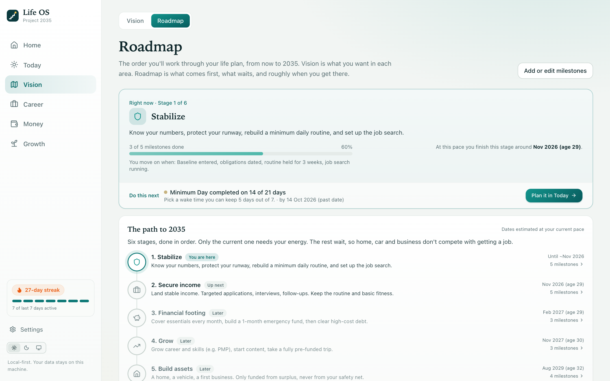
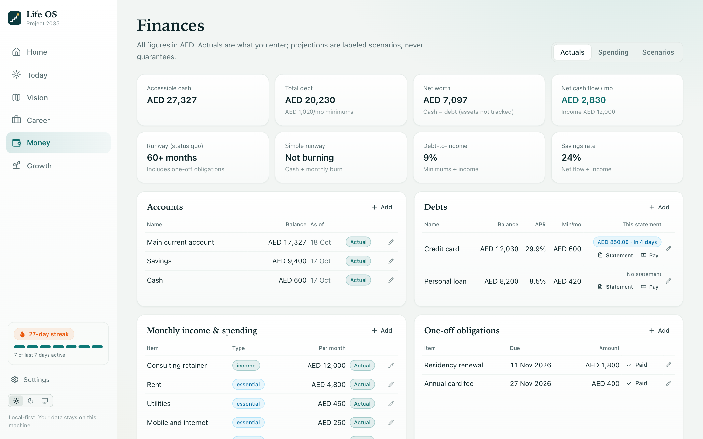
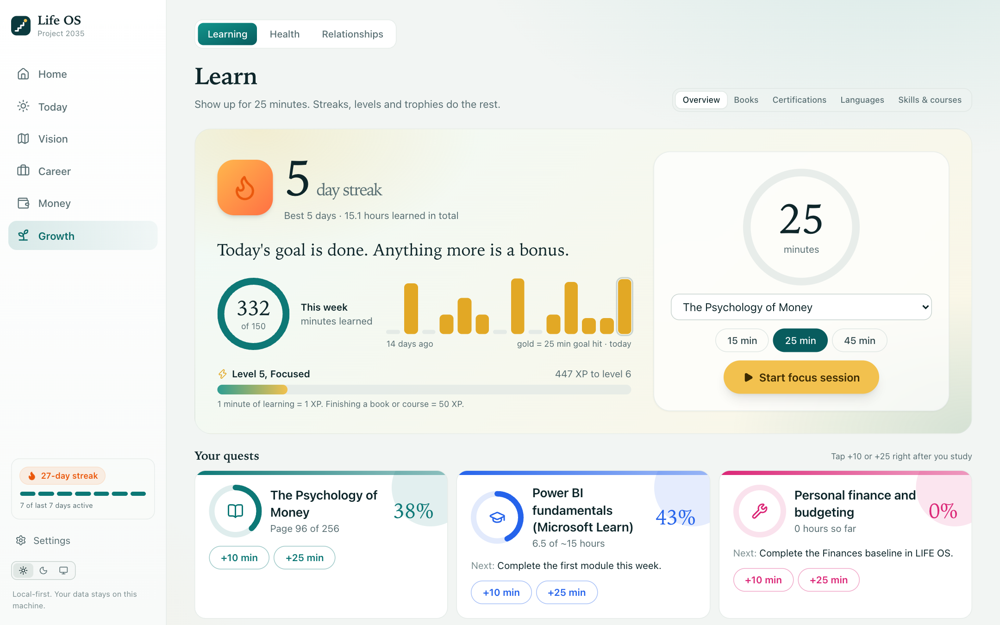

# LIFE OS

A local-first personal operating system that turns long-term goals into a daily plan you can actually follow. It combines a staged life roadmap, a daily planner, habit tracking, a job-search pipeline, personal finances and a weekly review in one app. Everything runs on your own machine and nothing leaves it.

I designed and built it as a product-management project: I started from one problem, defined the users and the scope, made trade-offs, and shipped it as working software.



> All data in the screenshots and the demo is fictional. See [Try the demo](#try-the-demo).

## The problem

Most life-planning tools stop at the plan. A vision board and a ten-year roadmap feel productive, but they do not tell you what to do at 9 a.m. on a Tuesday, and they break the first time you miss a week.

LIFE OS is built around the opposite idea: **every long-term goal is cut down into measurable milestones and small daily actions, and the system adapts when you fall behind.**

## Who it is for

Someone in a transition (between jobs, rebuilding finances, restarting routines) who needs structure without guilt, and who does not want to hand personal financial or health data to a cloud service.

## What it does

| Area | What it solves |
|---|---|
| **Roadmap** | Six ordered stages (Stabilize, Secure income, Financial footing, Grow, Build assets, Freedom). One stage gets your focus at a time; later stages stay locked until the current one is stable. Dates are estimated from your actual pace, with ages at each milestone. |
| **Today** | A daily plan with three capacity modes (Minimum, Standard, Deep Work), a timeline with free gaps, and a "pick your top 3" ritual so a bad day still counts. |
| **Career** | A job-search pipeline (board and table), network contacts, interview log and conversion insights. Follow-ups are surfaced when overdue. |
| **Money** | Actual balances and debts (never invented), runway, debt payoff (avalanche vs snowball), spending log and clearly labelled scenarios. |
| **Habits, Health, Reading, Learning** | Habit streaks with a "minimum version" for hard days, optional body metrics, a one-book-a-month plan, and a learning hub for certifications and languages. |
| **Weekly review** | A short review that pulls in the week's data, so decisions are made from facts. |
| **Coach (optional)** | An in-app assistant that reads a snapshot of your own data and can add tasks or log spending. |



## Product decisions worth knowing about

- **Plans are seeded, facts are not.** The starter data contains templates only. No balances, achievements or applications are ever pre-filled, so every number on screen is something the user entered.
- **Staged, not parallel.** Nine life areas competing for attention is how people quit. The roadmap gates later stages behind an earlier one being stable.
- **A "Minimum Day" exists on purpose.** The product is judged on whether it survives a bad week, so every routine has a smaller version that still counts.
- **Projections are labelled and computed on the fly.** They are never stored as if they were actuals.
- **Local-first.** One SQLite file, no accounts, optional passcode. A JSON export and restore are built in.

## Screenshots

| Today | Roadmap |
|---|---|
|  |  |
| **Money** | **Learning** |
|  |  |

## Try the demo

The demo loads a fictional person about five weeks into the plan, so every screen has data.

```bash
git clone <this repo>
cd life-os
npm install --include=dev
npm run demo          # builds, seeds data/demo.db, serves http://localhost:3100
```

The demo database is rebuilt every time you run the command. Your own data is never touched.

## Run it for real

```bash
npm install --include=dev
npm run build
npm start             # http://localhost:3000
```

Requires Node.js 20 or newer. On first start the database is created at `data/life-os.db` with planning templates only. Run the tests with `npm test`. More detail is in the [technical guide](docs/GUIDE.md).

## Tech

Next.js 15 (App Router) · React 19 · TypeScript · Tailwind CSS · Recharts · SQLite (better-sqlite3) · Vitest.

- One typed schema (`lib/schema.ts`) drives the database, the generic CRUD API and additive migrations.
- Pure logic (dates, recurrence, runway, amortisation, debt payoff, planner capacity) is separated from the UI and unit tested.
- Optional HTTP Basic passcode for use beyond localhost (`LIFEOS_PASSCODE`).

## Configuration

| Variable | Purpose |
|---|---|
| `LIFEOS_DB_PATH` | Where the SQLite file lives (default `./data/life-os.db`) |
| `LIFEOS_PASSCODE` | Require a passcode (HTTP Basic) if you expose the app beyond your machine |
| `LIFEOS_DEMO=1` | Seed fictional demo data (used by `npm run demo`) |
| `ANTHROPIC_API_KEY` | Optional, enables the Coach. Can also be saved in Settings. |

## What I would do next

- Weekly review insights segmented by life area (what moved, what stalled)
- Mobile-first quick capture for spending and check-ins
- Import from bank statements (CSV) to cut manual entry
- Hosted read-only demo

## Author

Built by Mark Gomez, Product Manager. Released under the MIT licence.
